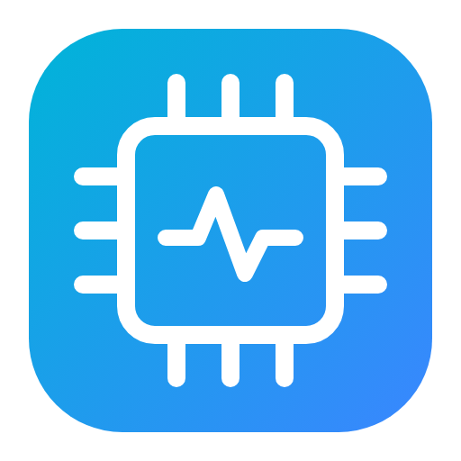

# ESP32 Studio

Entorno de desarrollo integrado (IDE) para **Windows** para escribir, compilar, simular y cargar firmware en microcontroladores **ESP32 de Espressif**, con un dashboard propio y tu marca.



## Funciones

| Área | Qué incluye |
|---|---|
| **Dashboard** | Logos y nombre de tu marca, proyecto activo, placa, dispositivos USB conectados, uso de Flash/RAM de la última compilación (medidores), estado de la cadena de herramientas, proyectos recientes y galería de plantillas. |
| **Editor** | Monaco (el motor de VS Code): resaltado C/C++, minimapa, pestañas, explorador de archivos, autocompletado con snippets de Arduino/ESP32/FreeRTOS/ESP-IDF, errores marcados en el código y panel de Problemas. |
| **Compilar / Cargar** | Proyectos **Arduino** (arduino-cli + núcleo arduino-esp32), **PlatformIO** (`platformio.ini`) y **ESP-IDF** (`idf.py`). Se detecta el tipo automáticamente. |
| **Simulador** | **Wokwi CLI**: simula el ESP32 con LEDs, pulsadores, sensores, pantallas, servos… y consola serie interactiva. **QEMU de Espressif**: emulación a nivel de instrucciones (ESP32, ESP32-C3 y ESP32-S3). Incluye un **diseñador visual de circuito** que genera `diagram.json`. |
| **Monitor serie y plotter** | Velocidades de 9600 a 921600, marcas de tiempo, envío con fin de línea configurable, exportación del registro y gráfica en tiempo real (`etiqueta:valor` o valores separados por coma/espacio). |
| **Flash (esptool)** | Info del chip y de la flash, lectura de MAC, borrado completo, escritura de `.bin` en cualquier dirección y respaldo de la flash. |
| **Librerías** | Búsqueda, instalación y desinstalación desde el índice de Arduino. |
| **Pinout** | Referencia de GPIO para ESP32, ESP32-S3 y ESP32-C3: ADC, touch, DAC, PWM, buses, pines de arranque (strapping) y pines prohibidos. |
| **Ajustes** | Instalación de herramientas con un clic, rutas personalizadas, token de Wokwi, preferencias del editor y **personalización de marca**. |

Atajos (como en Arduino IDE): `Ctrl+R` compilar · `Ctrl+U` cargar · `F5` simular · `Ctrl+S` guardar · `Ctrl+N` nuevo · `Ctrl+O` abrir · `Ctrl+Shift+M` monitor.

## Instalación en Windows

### Opción A — Instalador (recomendado)
Cada push a GitHub ejecuta el workflow **Build ESP32 Studio (Windows)**. Descarga el artefacto `ESP32-Studio-Windows` desde la pestaña *Actions* y ejecuta `ESP32 Studio Setup x.y.z.exe` (o la versión portable).

### Opción B — Desde el código
Requisitos: [Node.js 20+](https://nodejs.org) y Git.

```powershell
git clone https://github.com/magbi1/aplicacion_esp32.git
cd aplicacion_esp32
npm install
npm start            # ejecutar el IDE
npm run dist         # generar el instalador en .\dist
```

## Primer uso

1. Abre **Ajustes → Cadena de herramientas** y pulsa **Instalar** en *Núcleo ESP32* (descarga `arduino-cli` automáticamente e instala el núcleo de Espressif con esptool y los compiladores Xtensa/RISC-V).
2. Para simular con Wokwi: pulsa **Instalar** en *Wokwi CLI*, crea un token gratuito en <https://wokwi.com/dashboard/ci> y pégalo en **Preferencias → Token de Wokwi CLI**.
3. (Opcional) Para QEMU instala [ESP-IDF](https://dl.espressif.com/dl/esp-idf/) y luego pulsa **Instalar** en *QEMU Espressif*.
4. Conecta tu placa. Si no aparece el puerto COM, instala el driver **CP210x** (Silicon Labs) o **CH340/CH9102** (WCH).
5. **Inicio → Nuevo proyecto**, elige una plantilla y pulsa **Compilar**, **Cargar** o **Simular**.

## Tus logos

Hay dos formas de poner tu marca:

- **Desde la app:** *Ajustes → Marca y logos* → *Logo principal* / *Logo secundario* (PNG, SVG, JPG, WEBP o ICO), nombre de la aplicación y empresa. Se guardan en tu perfil de usuario.
- **En el código (para el instalador):** reemplaza `assets/logos/logo.svg` y `assets/logos/logo-secondary.svg` (o cambia las rutas en `branding.json`) y reemplaza `build/icon.ico` / `build/icon.png` por el icono de tu marca (256×256 o mayor). En `branding.json` también puedes cambiar `appName`, `company`, `tagline` y `accentColor`.

Los logos incluidos son provisionales.

## Plantillas incluidas

Blink · Pulsador con interrupción · PWM fade (LEDC) · Servo · Potenciómetro + plotter · DHT22 · OLED SSD1306 · Escáner Wi-Fi · Servidor web · Deep sleep · Tareas FreeRTOS · Servidor BLE · ESP-IDF Blink · PlatformIO Blink.
Las marcadas como *Simulable* traen su `diagram.json` listo para Wokwi.

## Estructura

```
src/main/        Proceso principal de Electron (Node.js)
  main.js        Ventana e IPC
  toolchain.js   Detección/instalación de arduino-cli, núcleo, esptool, Wokwi, QEMU, PlatformIO, ESP-IDF
  builder.js     Compilación y carga + análisis de memoria y errores
  simulator.js   Wokwi CLI y QEMU (genera wokwi.toml e imagen de flash)
  devices.js     Puertos, monitor serie, esptool y librerías
  projects.js    Proyectos, plantillas y archivos
src/renderer/    Interfaz (HTML/CSS/JS + Monaco)
templates/       Plantillas de proyecto
assets/logos/    Logos de la marca
build/           Iconos del instalador
```
